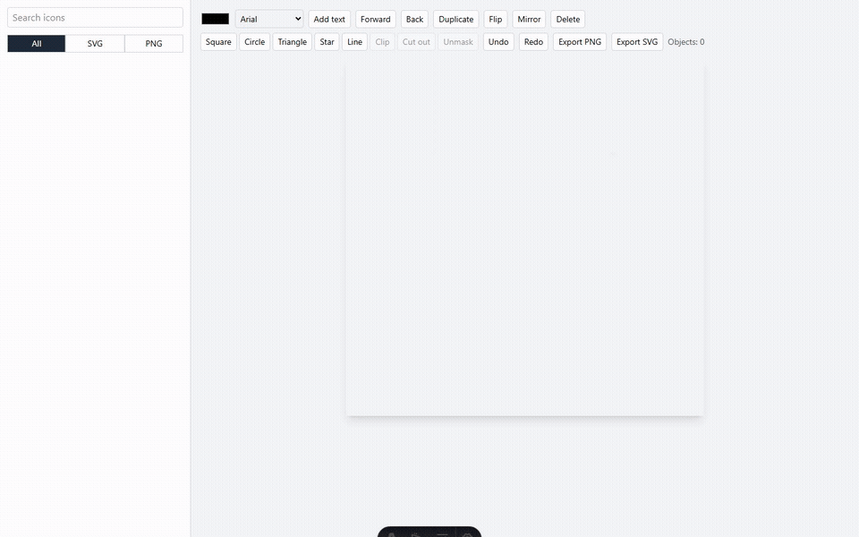

# Logomaker

A logomakr-style logo editor built on [The Noun Project](https://thenounproject.com) icon API. Search for icons, click one to drop it on the canvas, arrange it, and export a PNG or SVG.

Built with Astro (SSR, node adapter), Vue, Tailwind v4 and fabric.js.



[Watch the full-quality demo (MP4, 42s)](docs/demo.mp4)

## Features

- **Search**: Noun Project icon search with Load more. Each result is tagged **SVG** or **PNG**, and an All / SVG / PNG filter narrows the list.
- **Canvas**: a 600×600 artboard. Move, scale and rotate with handles; recolor, flip, duplicate, delete, bring forward and send back.
- **Text**: add text with a font picker (Arial, Georgia, Impact, Courier New, Trebuchet MS, Verdana).
- **Shapes**: square, circle, triangle, star and line.
- **Masking**: select an icon and a shape, then choose **Clip** (the icon shows only inside the shape) or **Cut out** (the shape punches a hole in the icon). **Unmask** gets the shape back. The mask moves with the object.
- **Mirror mode**: whatever you do on one side of the vertical center line is mirrored on the other side.
- **Undo/redo**: buttons, Ctrl+Z and Ctrl+Y. Delete or Backspace removes the selection.
- **Export**: PNG at 2× (1200×1200) or SVG. Cut-out masks export as SVG `<mask>` elements.

## Setup

You need Node 22+, pnpm 10, and a Noun Project API key and secret.

```sh
# in your shell environment (never committed)
export THEN_KEY=your_key
export THEN_SEC=your_secret

pnpm install
pnpm dev            # http://localhost:4321
```

See `.env.example` for the variable names. The credentials stay on the server: the browser only talks to `/api/*`, which signs requests with OAuth 1.0a.

## Docker

```sh
docker compose up -d --build   # http://localhost:4321
```

`compose.yaml` passes `THEN_KEY` and `THEN_SEC` in from your shell at runtime, so they're never baked into the image. The Dockerfile pins pnpm 10.18.3 through corepack, because the newer pnpm that Node 22's corepack picks rejects freshly published packages.

## Tests

```sh
pnpm test        # vitest unit tests (OAuth signing, API routes, history)
pnpm test:e2e    # Playwright: editor, UI, and a live API smoke test
```

The live spec (`tests/e2e/live.spec.ts`) is skipped when `THEN_KEY` isn't set. The first time, run `pnpm exec playwright install chromium`.

## Project layout

| Path | What it does |
|---|---|
| `src/lib/tnp.ts` | OAuth 1.0a signing and the signed `tnpGet` call (`node:crypto`, no OAuth library) |
| `src/pages/api/search.ts` | `GET /api/search?q=&next=&pd=` proxies TNP icon search |
| `src/pages/api/icon/[id].ts` | `GET /api/icon/:id` returns the SVG, or the PNG thumbnail fallback. Only fetches from `*.thenounproject.com` and doesn't follow redirects |
| `src/lib/editor.ts` | fabric.js wrapper: objects, mirror, shapes/masks, history, export |
| `src/lib/history.ts` | undo/redo stack |
| `src/components/LogoMaker.vue` | the whole UI |

## Known limitations

- **SVGs on the current Noun Project plan**: the API key only gets SVGs for public-domain icons. CC-licensed icons have no `icon_url`, and `/download` returns 403. So the **SVG** filter searches public-domain icons only (`pd=1`), and other icons come in as PNG thumbnails, which you can still recolor with a tint. On a paid plan, search the code for `TNP-PLAN`: drop `pd=1` and fetch SVGs from `/v2/icon/{id}/download?filetype=svg&color=000000`.
- Skew isn't mirrored. Undoing a Mirror toggle restores the pair links but not the toggle state.
- The color and font pickers don't change to show the selected object's color or font.
- Icons from The Noun Project need attribution unless they're public domain. See their license terms.
