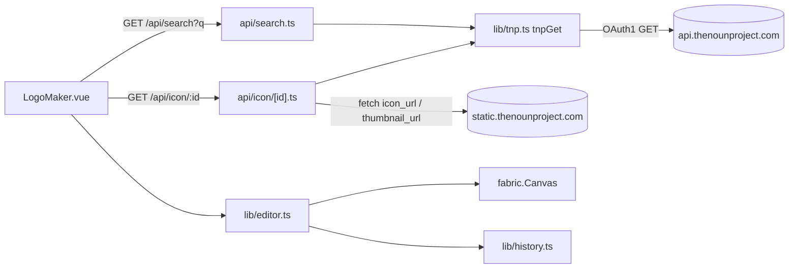
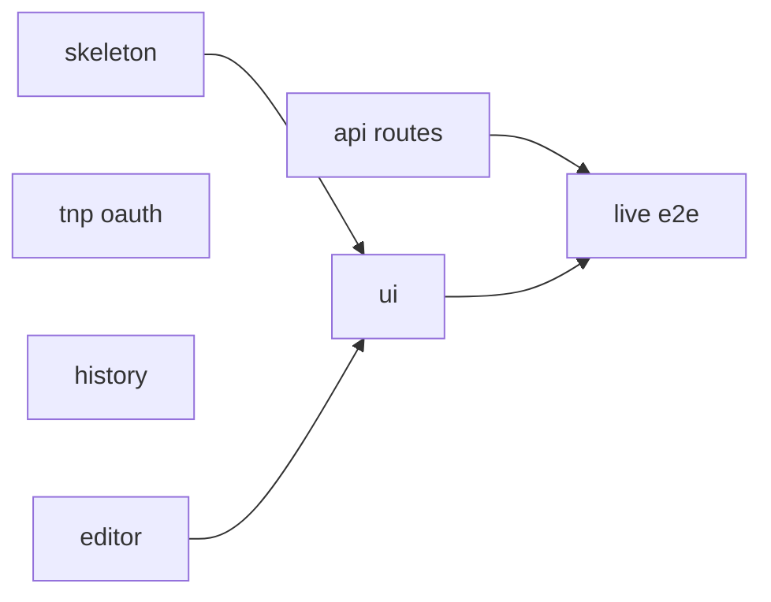

# Logomaker Implementation Plan

**Goal:** A logomakr-style web app. You search The Noun Project (TNP), click results to drop icons on a canvas, then move, scale, rotate and recolor them, add text, undo or redo changes, and export a PNG or SVG.
**Architecture:** Astro server output (node adapter) runs two API routes that proxy TNP using hand-rolled OAuth1 signing. One Vue island (`LogoMaker.vue`) drives a fabric.js canvas through a thin `editor.ts` wrapper, and a pure `history.ts` handles undo and redo.
**Tech stack:** pnpm, astro ^5, @astrojs/node, @astrojs/vue, vue ^3, tailwindcss ^4 + @tailwindcss/vite, fabric ^6, vitest, @playwright/test, TypeScript.
**Spec:** C:\Github\_web\logomaker\plan.md
**Detail:** contracts
**Target-min:** 11
**Orchestrator:** ai

## Global constraints
- TNP creds come from `process.env.THEN_KEY` / `process.env.THEN_SEC` and are never sent to the client.
- TNP base `https://api.thenounproject.com`. Search: `/v2/icon?query=&limit=48&thumbnail_size=200&include_svg=1[&next_page=]`. Icon: `/v2/icon/{id}`.
- OAuth 1.0a, HMAC-SHA1, no token, signed with `node:crypto`. No OAuth library.
- Unit tests: `pnpm vitest run` (only `tests/unit/**/*.test.ts`). E2E: `pnpm exec playwright test` (testDir `tests/e2e`, webServer `pnpm dev --port 4321`, baseURL `http://localhost:4321`, reuseExistingServer).
- The artboard is 600×600 with a white background. PNG export uses `multiplier: 2`. Fonts: Arial, Georgia, Impact, Courier New, Trebuchet MS, Verdana.
- No-SVG icons use the PNG fallback (Ruling: user choice). Recoloring a PNG applies a fabric `BlendColor` tint.

## Main diagram

## File structure
- `package.json`, `astro.config.mjs`, `tsconfig.json`, `vitest.config.ts`, `playwright.config.ts`, `.env.example`: skeleton (T0)
- `src/styles/global.css`: `@import "tailwindcss";` (T0)
- `src/pages/index.astro`: page shell that mounts `<LogoMaker client:only="vue" />` (T0)
- `src/lib/tnp.ts`: OAuth1 header and signed GET (T1)
- `src/pages/api/search.ts`, `src/pages/api/icon/[id].ts`: proxy routes (T2)
- `src/lib/history.ts`: undo/redo stack (T3)
- `src/lib/editor.ts`: fabric wrapper (T4)
- `src/components/LogoMaker.vue`: the whole UI (T5)
- `tests/e2e/live.spec.ts`: live TNP smoke (T6)

## Task graph

```mermaid
%% schedule
gantt
  title Predicted schedule (mm:ss)
  dateFormat X
  axisFormat %M:%S
  section lane 1
  T2 api routes :t2, 0, 400s
  T6 live e2e :t6, 667, 334s
  section lane 2
  T0 skeleton :t0, 0, 334s
  T5 ui :t5, 334, 334s
  section lane 3
  T1 tnp oauth :t1, 0, 334s
  section lane 4
  T3 history :t3, 0, 334s
  section lane 5
  T4 editor :t4, 0, 334s
```

critical path: T0 → T5 → T6 (16.7 min) · peak width 5 · predicted build 16.7 min · predicted total ≈ 20.2 min (target ✗ 11.0)

### T0 skeleton · Complexity 1 · Est. context 25k
**Owns:** package.json, pnpm-lock.yaml, .gitignore, astro.config.mjs, tsconfig.json, vitest.config.ts, playwright.config.ts, .env.example, src/styles/global.css, src/pages/index.astro, src/components/LogoMaker.vue
**Components:** 1
**LOC owned:** 90
**Tests:** fast
**Kind:** mechanical
**Model:** haiku
**Est. time:** 1.5 min
**Produces:** none
**Test code (verbatim):** `pnpm install` exits 0. `pnpm exec playwright install chromium` exits 0. `pnpm astro check` runs.
**Steps:** 1 write the files, 2 `pnpm install`, 3 install chromium, 4 `pnpm vitest run --passWithNoTests` exits 0
**Notes:** `astro.config.mjs`: `output: 'server'`, `adapter: node({mode:'standalone'})`, `integrations: [vue()]`, `vite: {plugins: [tailwindcss()]}`. `vitest.config.ts` include `tests/unit/**/*.test.ts`. `index.astro` imports global.css and is a full-height page with title "Logomaker". `LogoMaker.vue` is a stub, `<template>
</template>`, that T5 replaces. `.env.example` lists `THEN_KEY=` and `THEN_SEC=`.

## Package: server (HTTP service: protocol, encoding, numeric, state; risks: SSRF via icon_url, id injection into path, secret leak)
**Probe entry:** serve=pnpm dev --port 4321

### T1 tnp oauth · Complexity 3 · Est. context 30k
**Owns:** src/lib/tnp.ts, tests/unit/tnp.test.ts
**Components:** 1
**LOC owned:** 70
**Tests:** fast
**Kind:** mechanical
**Model:** haiku
**Est. time:** 1.5 min
**Produces:** tnp.authHeader(url: string, params: Record<string,string>, key: string, secret: string, nonce: string, ts: string) -> string
**Produces:** tnp.tnpGet(path: string, params: Record<string,string>) -> Promise<any>
e.g. tnpGet('/v2/icon', {query:'cat', limit:'48'}) -> {icons:[{id:'123', thumbnail_url:'https://static.thenounproject.com/png/123-200.png', icon_url:'https://static.thenounproject.com/svg/123.svg', attribution:'Cat by Ann from Noun Project'}], next_page:'abc'}
e.g. tnpGet('/v2/icon/123', {}) -> {icon:{id:'123', icon_url:'https://static.thenounproject.com/svg/123.svg', thumbnail_url:'https://static.thenounproject.com/png/123-200.png'}}
e.g. tnpGet('/v2/icon', {query:'x'}) with upstream 403 -> throws Error('upstream 403')
**Review Focus:** `test_percent_encoding`: param `query:'a b*'` encodes as `a%20b%2A` in the base string; `test_secret_not_in_header`: header never contains `secret`
**Test code:** `test_signature_vector`: authHeader('https://api.thenounproject.com/v2/icon', {query:'cat', limit:'1'}, 'k', 's', 'n', '1') signature equals base64 HMAC-SHA1 with key `s&` over base string `GET&https%3A%2F%2Fapi.thenounproject.com%2Fv2%2Ficon&limit%3D1%26oauth_consumer_key%3Dk%26oauth_nonce%3Dn%26oauth_signature_method%3DHMAC-SHA1%26oauth_timestamp%3D1%26oauth_version%3D1.0%26query%3Dcat` (the test builds that literal string itself). `test_header_shape`: starts with `OAuth ` and contains `oauth_consumer_key="k"`, `oauth_signature_method="HMAC-SHA1"`. `test_tnpGet_throws`: with fetch stubbed to 403, it rejects with `upstream 403`. `test_tnpGet_url`: with fetch stubbed, it was called with `https://api.thenounproject.com/v2/icon?query=cat` and an Authorization header.
**Steps:** 1 failing tests, 2 FAIL, 3 implement, 4 PASS
**Notes:** RFC 3986 encoding: `encodeURIComponent` plus `!*'()` escaped. Sort params by key. Nonce `crypto.randomBytes(16).toString('hex')`.

### T2 api routes · Complexity 4 · Est. context 35k
**Owns:** src/pages/api/search.ts, src/pages/api/icon/[id].ts, tests/unit/api.test.ts
**Components:** 2
**LOC owned:** 110
**Tests:** fast
**Model:** sonnet
**Est. time:** 2.5 min
**Consumes:** tnp.tnpGet(path: string, params: Record<string,string>) -> Promise<any> (T1)
**Produces:** GET /api/search?q=&next= -> JSON {icons:{id,thumb,attribution}[], next:string|null}
e.g. GET /api/search?q=cat -> 200 {"icons":[{"id":"123","thumb":"https://static.thenounproject.com/png/123-200.png","attribution":"Cat by Ann from Noun Project"}],"next":"abc"}
e.g. GET /api/search -> 400 {"error":"missing q"}
**Produces:** GET /api/icon/:id -> image/svg+xml text, or image/png bytes when no icon_url
e.g. GET /api/icon/123 -> 200 content-type image/svg+xml body `<svg ...>`
e.g. GET /api/icon/abc -> 400 {"error":"bad id"}
**Review Focus:** `test_icon_rejects_foreign_host`: icon_url `https://evil.com/x.svg` gives 502 and no fetch of evil.com; `test_icon_png_fallback`: no icon_url, so it fetches thumbnail_url and returns content-type image/png; `test_upstream_error_502`: tnpGet throws `upstream 403`, so it returns 502 {"error":"upstream 403"}; `test_search_next_passthrough`: `?q=cat&next=abc` calls tnpGet with `next_page:'abc'`
**Test code:** `vi.mock('../../src/lib/tnp')` returns the T1 e.g. values. Call the exported `GET({url: new URL(...), params:{id}})` directly and stub `globalThis.fetch` for the CDN.
**Steps:** 1 failing tests, 2 FAIL, 3 implement, 4 PASS
**Notes:** id must match `/^\d+$/`. CDN fetch allowed only when `new URL(u).hostname` ends with `.thenounproject.com`. Set `export const prerender = false`. Map `thumbnail_url` to `thumb`.

## Package: client (web UI: protocol via API, encoding/XSS; risks: tainted canvas on export, undo replaying across load, attribution text rendered as HTML)
**Probe entry:** serve=pnpm dev --port 4321

### T3 history · Complexity 2 · Est. context 22k
**Owns:** src/lib/history.ts, tests/unit/history.test.ts
**Components:** 1
**LOC owned:** 50
**Tests:** fast
**Kind:** mechanical
**Model:** haiku
**Est. time:** 1.5 min
**Produces:** history.createHistory<T>(limit: number = 50) -> {push(s: T): void, undo(): T | undefined, redo(): T | undefined, canUndo(): boolean, canRedo(): boolean}
e.g. h=createHistory(); h.push('a'); h.push('b'); h.undo() -> 'a'; h.redo() -> 'b'
e.g. h=createHistory(); h.push('a'); h.undo() -> undefined
**Test code:** `test_undo_redo`: as in e.g. 1. `test_single_state`: as in e.g. 2, and canUndo() is false. `test_push_clears_redo`: push a,b, undo, push c, then redo() is undefined and undo() is 'a'. `test_limit`: createHistory(2), push a,b,c, undo() is 'b', then undo() is undefined.
**Steps:** 1 failing tests, 2 FAIL, 3 implement, 4 PASS
**Notes:** undo returns the state *before* the current one, and the current one stays the latest push.

### T4 editor · Complexity 5 · Est. context 45k
**Owns:** src/lib/editor.ts, tests/e2e/editor.spec.ts
**Components:** 1
**LOC owned:** 170
**Tests:** slow
**Model:** sonnet
**Est. time:** 3.5 min
**Consumes:** history.createHistory<T>(limit: number = 50) -> {push(s: T): void, undo(): T | undefined, redo(): T | undefined, canUndo(): boolean, canRedo(): boolean} (T3)
**Produces:** editor.createEditor(el: HTMLCanvasElement) -> Editor
**Produces:** Editor methods: addSvg(svg: string) -> Promise<void> · addImage(url: string) -> Promise<void> · addText(text: string, font: string) -> void · setColor(hex: string) -> void · setFont(font: string) -> void · forward() -> void · backward() -> void · duplicate() -> Promise<void> · flip() -> void · remove() -> void · undo() -> Promise<void> · redo() -> Promise<void> · exportSVG() -> string · exportPNG() -> string · count() -> number · onChange(cb: () => void) -> void
e.g. addSvg('<svg xmlns="http://www.w3.org/2000/svg" viewBox="0 0 10 10"><path d="M0 0h10v10H0z"/></svg>'); count() -> 1
e.g. after that, undo(); count() -> 0; redo(); count() -> 1
e.g. exportSVG() -> string starting '<?xml' and containing '<svg'
**Review Focus:** `test_undo_no_history_feedback`: undo then redo does not push new history entries (count stays right after 3 undo/redo cycles); `test_setColor_svg_group`: setColor('#ff0000') makes every path in the active group have fill '#ff0000'; `test_png_export_after_image`: addImage(blob object URL) then exportPNG() starts with 'data:image/png' (canvas not tainted)
**Test code:** Playwright, `page.goto('/')`, then `page.evaluate(async () => { const {createEditor} = await import('/src/lib/editor.ts'); const c=document.createElement('canvas'); document.body.append(c); const e=createEditor(c); ... })`. It asserts the 3 e.g. lines, the Review Focus tests, `test_text`: addText('ACME','Impact'), count() is 1, exportSVG() contains 'ACME', and `test_remove`: add, remove, count() is 0.
**Steps:** 1 failing tests, 2 FAIL, 3 implement, 4 PASS
**Notes:** 600×600 white canvas. Added objects are centered, scaled to fit 200px, and made active. Snapshot `canvas.toJSON()` on `object:added|modified|removed`, skipped while a `restoring` flag is set during `loadFromJSON`. Push the empty initial state at create. PNG tint uses `filters.BlendColor({color, mode:'tint', alpha:1})` + `applyFilters()`. setColor on a group sets fill on every child that has a fill. exportPNG uses `toDataURL({format:'png', multiplier:2})`.

### T5 ui · Complexity 5 · Est. context 50k
**Owns:** src/components/LogoMaker.vue, tests/e2e/ui.spec.ts
**Components:** 1
**LOC owned:** 200
**Tests:** slow
**Model:** sonnet
**Est. time:** 4 min
**Consumes:** editor.createEditor(el: HTMLCanvasElement) -> Editor (T4) · GET /api/search?q=&next= -> JSON {icons:{id,thumb,attribution}[], next:string|null} (T2) · GET /api/icon/:id -> image/svg+xml text, or image/png bytes when no icon_url (T2)
**Produces:** none
**Review Focus:** `test_attribution_escaped`: attribution `` renders as text (Vue `{{ }}`, never v-html); `test_png_fallback_icon`: /api/icon/2 mocked as image/png, so clicking adds 1 object
**Test code:** Playwright with `page.route('/api/search*')` returning the T2 e.g. JSON and `page.route('/api/icon/*')` returning the T4 e.g. SVG. Tests: `test_search_shows_results`: fill search with 'cat' + Enter shows 1 result img. `test_click_adds`: click result shows `[data-testid=count]` text '1'. `test_color`: select, then color input '#ff0000' → no error, count still 1. `test_undo_button`: click Undo, count '0'. `test_text_button`: Add text, count '1'. `test_export_svg`: click Export SVG, download `logo.svg` contains '<svg'. `test_export_png`: download `logo.png` size > 0. `test_load_more`: when next is non-null, the Load more button calls `/api/search?q=cat&next=abc`.
**Steps:** 1 failing tests, 2 FAIL, 3 implement, 4 PASS
**Notes:** Layout is a left sidebar (search input, results grid, Load more) and a center canvas with a toolbar above it: color, font select (Global fonts), Add text, Forward, Back, Duplicate, Flip, Delete, Undo, Redo, Export PNG, Export SVG. Delete/Backspace removes the selection unless focus is in an input. Ctrl+Z/Ctrl+Y undo and redo. A result click fetches /api/icon/:id. An `image/svg+xml` response goes to addSvg(text), otherwise addImage(URL.createObjectURL(blob)). Downloads use a temporary `<a download>`. Count is updated via onChange.

## Package: integration
**Probe entry:** serve=pnpm dev --port 4321

### T6 live e2e · Complexity 2 · Est. context 25k
**Owns:** tests/e2e/live.spec.ts
**Components:** 1
**LOC owned:** 40
**Tests:** slow
**Model:** sonnet
**Est. time:** 1.5 min
**Consumes:** GET /api/search?q=&next= -> JSON {icons:{id,thumb,attribution}[], next:string|null} (T2)
**Produces:** none
**Test code:** `test.skip(!process.env.THEN_KEY)`. `test_live_search_api`: request `/api/search?q=star` returns 200 and icons.length > 0. `test_live_flow`: in the UI, search 'star', click the first result, count '1', and the Export SVG download contains '<svg'.
**Steps:** 1 write, 2 run with real env, 3 PASS
**Notes:** No mocks. If TNP returns 401, report the response body. Don't loosen the test.

## Review Focus
- server: HTTP service; protocol, encoding. Risks: SSRF, bad id, secret leak. Opus security pass on T1/T2.
- client: web UI; protocol, encoding (XSS). Risks: tainted canvas, undo loop.

## Self-review
Coverage, placeholders, types, graph, fields: checked.
